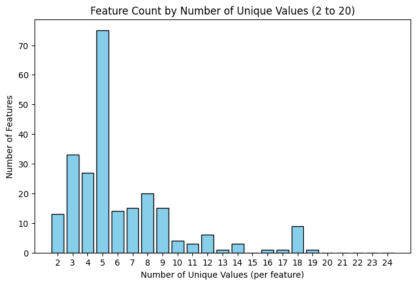
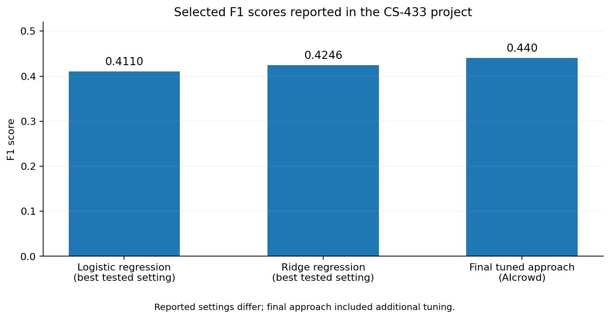

# Cardiovascular Disease Risk Prediction with Machine Learning

**EPFL · CS-433 Machine Learning · 2025 · Team project**  
**Python · NumPy · Data Preprocessing · Ridge Regression · Logistic Regression · Model Evaluation**

> **Project summary:** Investigating cardiovascular disease risk prediction from large-scale behavioral, demographic, and clinical survey data. The emphasis is on preparing a noisy, highly imbalanced dataset, comparing interpretable baseline models, and optimizing classification performance.

## At a glance

| Measure | Reported value |
|---|---:|
| Samples | 328,135 |
| Input features | 321 |
| Positive class proportion | 8.83% |
| Final validation F1 | **0.4278** |
| AIcrowd evaluation F1 | **0.440** |

*The results above come from the [team project report](report/project-report.pdf). They are **reported outcomes**, not scores independently reproduced from the limited source-code snapshot included here.*

## Problem

Predict the presence of **myocardial infarction or coronary heart disease (MICHD)** from Behavioral Risk Factor Surveillance System (BRFSS) data. The dataset is challenging because of incomplete survey responses, many features, and a strong class imbalance. This makes raw accuracy a misleading metric, so the project prioritizes the **F1 score**.

## Approach

1. **Data cleaning:** identify invalid/non-response survey codes and convert them to missing values; eliminate highly incomplete features.
2. **Preprocessing and feature engineering:** distinguish numerical and categorical variables, impute missing values, filter outliers, standardize numerical features, and reduce low-variance/correlated features.
3. **Models:** compare **logistic regression** with **ridge regression**, implemented using NumPy-based routines in the shared code.
4. **Model selection:** tune regularization and decision thresholds, balancing precision and recall in the presence of a minority positive class.
5. **Evaluation:** use F1 as the main criterion, with results reported on validation data and the AIcrowd evaluation platform.

These steps summarize the **final report**. The available `data_preprocessing.py` contains one configuration of the preprocessing pipeline; some hyperparameter choices in that script differ from the final report.

## Exploratory analysis

The included notebook investigates the number of distinct feature values and the distribution of missing entries. The score chart summarizes selected report results.





*The feature-distribution figure comes from the team's exploratory notebook. The score comparison is a visualization of values reported in the final team report.*

## Selected results

| Approach / setting | Test F1 (reported) |
|---|---:|
| Ridge regression (best result in comparison table) | 0.4246 |
| Logistic regression (best result in comparison table) | 0.411 |
| Final tuned ridge approach (AIcrowd) | **0.440** |

In the report, ridge regression offered a slightly stronger F1 score than logistic regression in the compared settings. Additional tuning, feature processing, and threshold optimization improved the final result. See the [full report](report/project-report.pdf) for methodology, ablations, and discussion.

## Repository contents

```text
.
├── assets/                    # Exploratory plots from the notebook
├── dataset/                   # Instructions; original CSVs are excluded
├── report/
│   └── project-report.pdf     # Final team report
├── data_exploration.ipynb     # Data exploration and visualizations
├── data_preprocessing.py      # An archived preprocessing pipeline
├── helpers.py                 # CSV utilities and submission formatting
├── implementations.py         # NumPy regression implementations
├── run.py                     # Original incomplete submission scaffold
├── requirements.txt
└── README.md
```

## Inspecting the project locally

The Python environment can be prepared with:

```bash
python -m venv .venv
source .venv/bin/activate
pip install -r requirements.txt
```

The **exploratory notebook** and **preprocessing script** expect the original BRFSS course files (`x_train.csv`, `y_train.csv`, and `x_test.csv`) inside `dataset/`; those large files are deliberately omitted from this public repository. See [`dataset/README.md`](dataset/README.md). If you have authorized access, you can then explore the notebook or run:

```bash
python data_preprocessing.py
```

**Reproducibility note:** `run.py` is retained from the source archive but is **not an end-to-end working submission**: it refers to a prediction variable (`y_pred`) that is not defined. The final tuned training/prediction workflow used for the published 0.440 F1 is not fully present in this archive. No claim is made that the public code reproduces the paper score as-is.

## Team and attribution

This project was completed as part of **CS-433 Machine Learning at EPFL** by **Tazi Rhali, Chu Tommy, and Kamil Chaoui El Faiz**. It is presented as a **team effort**, not as individual work. Some helper and course-scaffold code may originate from the course material. See the [team report](report/project-report.pdf) for the full academic context.

## Limitations and responsible use

The evaluation concerns a course dataset and should **not** be interpreted as a clinically validated risk prediction tool. Strong class imbalance, missing information, survey-specific coding conventions, and unknown generalization to other populations limit real-world applicability. Raw participant-level datasets are not included.
